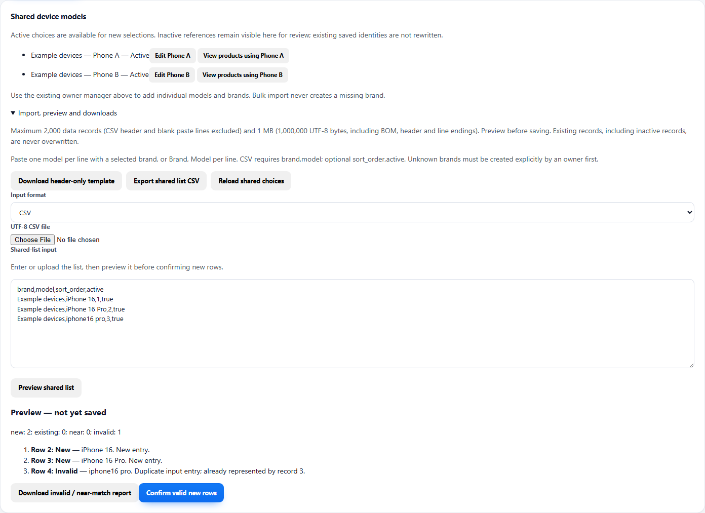
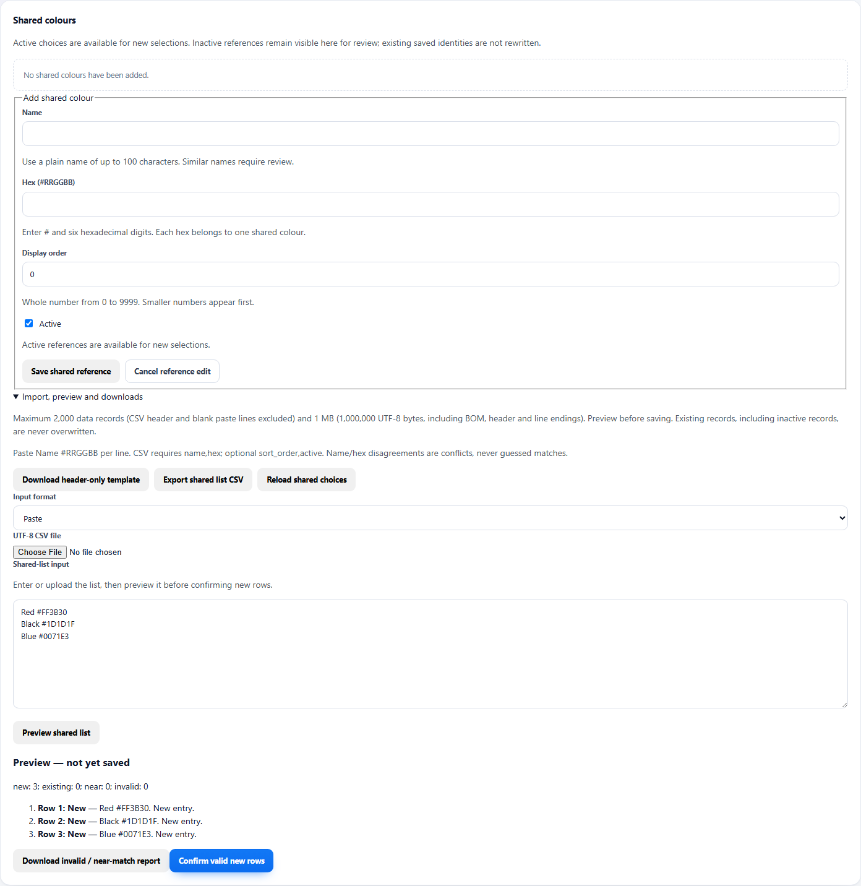
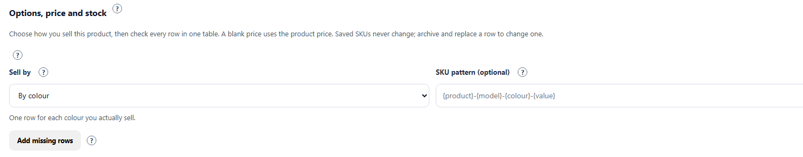
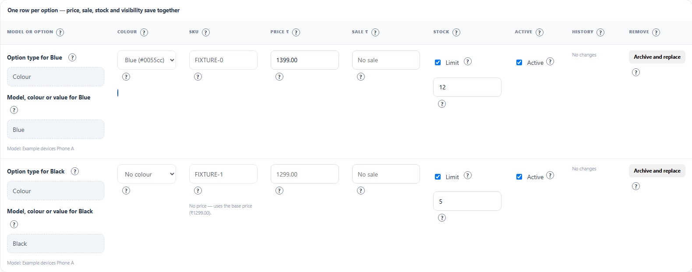
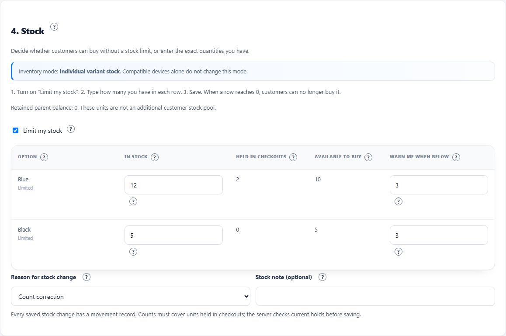

# Add a product with models and colours

> **One page.** This is everything needed to sell the same case in several phone
> models and colours, each with its own price and stock.

## What you need first

- The phone model list (CSV or paste), one real model per line.
- The colour names and hex codes, for example `Red #FF3B30`.
- The price, sale price and real stock count for each option.
- One photo per colour (optional; a colour without photos keeps the main gallery).

Owners manage the shared model and colour lists. Store admins can add a model or
colour inline while editing a product, but they cannot rename, deactivate or
import lists.

## 1. Put the models and colours in the shared lists

Open **Store admin → Shared lists**.

### Models by CSV (owner)

1. Open **Import, preview and downloads**.
2. Press **Download header-only template**. It contains the columns
   `brand,model,sort_order,active`.
3. Fill one row per real model. The brand must already exist; brands are
   owner-created and are never invented from a CSV.
4. Choose the file under **UTF-8 CSV file**, then press **Preview shared list**.
5. Read every line of the preview:
   - **New** — will be created.
   - **Already in the list** — nothing will change.
   - **Did you mean …?** — a near match. Tick **I reviewed row 1** only if it is
     genuinely a different model.
   - An invalid row shows a plain reason and nothing is applied.
6. Press **Confirm valid new rows**.

A file with one misspelled duplicate (`iPhone16 pro`) warns you instead of
creating a second model. Uploading the same file twice changes nothing. The
limit is **2,000 data rows and 1 MB**; headers and blank lines do not count as
data rows.

### Colours by paste (owner)

1. Open **Import, preview and downloads** on the Colours list.
2. Paste one colour per line: `Red #FF3B30`, or use the CSV columns
   `name,hex,sort_order,active`.
3. Press **Preview shared list**, review, then **Confirm valid new rows**.

## 2. Start the product

Open **Products → New product**.

- **Basics**: name, active category, and the compatible devices you will really
  sell. Selecting a device does not create an option or extra stock.
- The six sections are one form. Moving between sections does **not** save.

## 3. Choose how you sell it

Open **3. Price and options**. In **Sell by** choose:

| Choice | Use when |
| --- | --- |
| One item | There is one physical version. |
| By colour | Only the colour changes. |
| By model | Only the phone model changes. |
| By model and colour | Both change; one row per real pair. |
| By another option | A name of your own, such as Wattage. |

Press **Add missing rows**. New rows start **inactive with zero stock**, so
nothing goes on sale by accident. The **SKU pattern** is optional and only
suggests new SKUs; a saved SKU never changes.

## 4. Fill the table

There is one row per option: **Model or option, Colour, SKU, Price, Sale,
Stock, Active, History, Remove**.

- A blank **Price** uses the product price.
- **Fill several rows at once** copies one price, sale or stock value into every
  active row. You can also set a different price for each colour.
- **Paste prices and stock** accepts a block copied from a spreadsheet: one line
  per active option, in table order — price, sale price, stock. Separate columns
  with Tab, a comma or a semicolon. A blank cell keeps the old value. The preview
  shows every row; nothing is applied if any line is wrong.
- Turn on **Active** for the rows you sell, then turn on **Limit my stock** and
  type the real count for that exact option.
- A large price change asks you to confirm. It is never blocked.
- **History** shows the old and new regular and sale prices, who changed them
  and when.

## 5. Give each colour its photos

Open **2. Photos**. Pick an existing image or upload a new one, then choose the
colour it belongs to. **Main** stays product-wide. A colour with no photo keeps
the main gallery; a colour with photos shows its own when the customer picks it.

## 6. Publish and check as a customer

1. Open **6. Review and publish**, turn on **Publish in the storefront**, then
   save.
2. Open the customer product page. Pick the model, then the colour. The photos,
   price and availability change together.
3. An option with no stock shows **Stock not available** and cannot be added to
   the bag. Sale mode still allows waiting for stock, and the exact option is
   checked again at checkout.
4. On the category page, choosing a model shows only products that really have
   that model, and the colour filter shows only colours that exist for it.

## If something looks wrong

| What you see | What it means |
| --- | --- |
| **Already in the list** | The import matched an existing name. Nothing was created. |
| **Did you mean …?** | A near match. Review it; tick the box only for a genuinely different model. |
| Option disabled or **Stock not available** | That exact option has no stock. A sibling option's stock is not used. |
| Price did not change | Check the option's own price. A blank price uses the product price. |
| An old order shows a different name | Orders keep what was sold. Renaming an option does not rewrite history. |
| Sale price warning | The sale price must be above zero and below that row's price. |
| **Sale cleared** in History | The sale was removed. It is not a price of ₹0.00. |

## Advanced appendix

The old long guide is kept in
[docs/advanced-products-and-catalog-guide.md](docs/advanced-products-and-catalog-guide.md).
Use it only when you deliberately want product types, mapped fields,
compatibility rules or the developer reference.

Screenshots use sample data. Your lists, prices and photos will differ.
