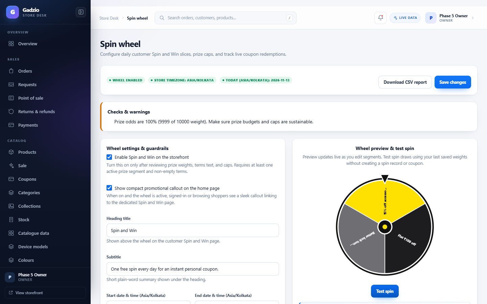
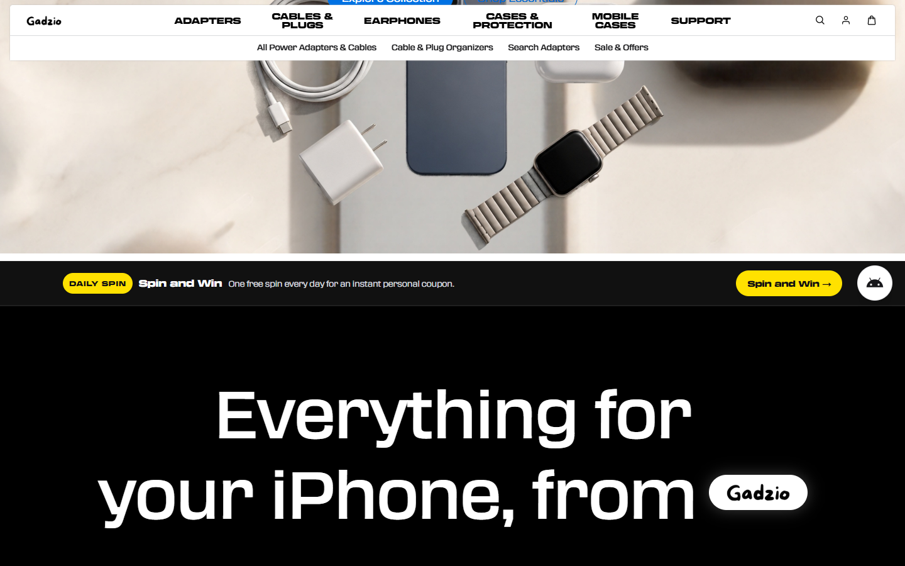
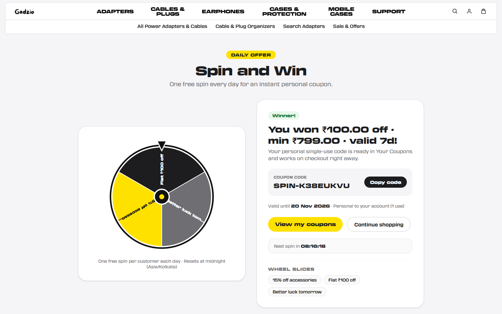
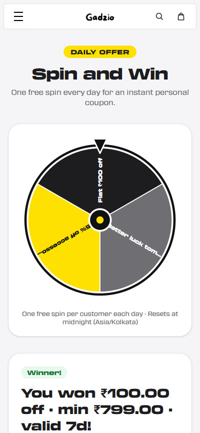
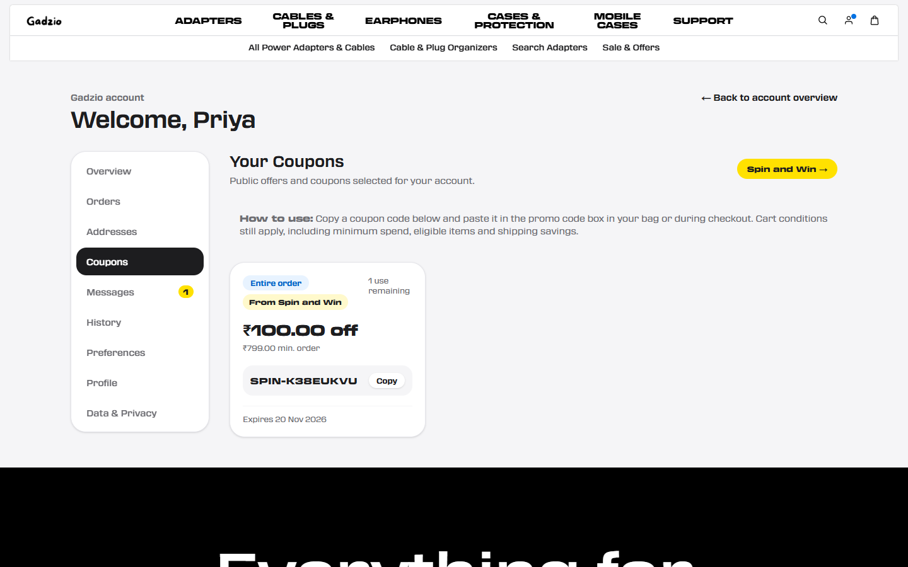

# Set up the daily Spin and Win wheel

> **One page.** Everything needed to configure, test, launch, and monitor the daily Spin and Win wheel in Store Admin — and where shoppers see it once turned on.
>
> **Scope note:** The **Free gift on orders** feature (Phases 1–2) is held until PayU staging confirmation and is not enabled yet. This guide covers the **Spin and Win wheel** (Phases 3–5).

---

## Where Spin and Win shows

By default after migration `0069`, the wheel is **disabled** (`enabled = false`, `show_on_home_page = false`) so nothing appears to customers until you add terms, review odds/caps, and save.

Once enabled in **Store Desk → Marketing → Spin wheel** (`/store-admin/marketing/spin-wheel`):

1. **Store Admin** (`/store-admin/marketing/spin-wheel`): settings, 2–12 wheel segments, live odds & WCAG contrast checker, warnings panel, **Test spin** preview, daily summary & recent spins table, CSV export (`/api/store-admin/spin-wheel/export`), and **Needs attention** alerts on Store Desk Overview (`/store-admin`) when a prize hits its daily cap.
2. **Home page banner** (`/`): compact black-and-yellow **Daily Spin — Spin and Win** strip linking to `/spin-and-win` (only shown when **"Show compact promotional callout on the home page"** is checked AND the wheel is open).
3. **Dedicated wheel page** (`/spin-and-win`): responsive interactive wheel for customers with Terms & Conditions acceptance, instant personal coupon code reward, copy button, and `Next spin in hh:mm:ss` countdown resetting at midnight (`Asia/Kolkata`).
4. **Account overview** (`/account`): a **Spin and Win** dashboard card showing either `"Spin now — 1 free spin ready today"` or `"Next spin in hh:mm:ss"`, plus a link under Quick Navigation → **Messages & Offers**.
5. **Account coupons** (`/account/coupons`) & **Messages** (`/account/messages`): won coupons appear immediately with a `"From Spin and Win"` badge, personal usage limit (`1 use remaining`), expiry date, and copy button, alongside an in-app `"spin_win"` message.

---

## 1. Configure slices, odds, caps, and guardrails

Open **Store Desk → Marketing → Spin wheel** (`/store-admin/marketing/spin-wheel`):

1. Review **Wheel settings & guardrails**:
   - **Enable Spin and Win on the storefront** (cannot be enabled until at least one active prize slice and non-empty Terms & Conditions exist).
   - **Show compact promotional callout on the home page** (optional home banner strip).
   - Optional **Start / End date & time** in store timezone (`Asia/Kolkata`).
   - **Max spins per IP address per day** (default `1`; raise carefully only if many real customers share mobile/office NAT).
   - **Minimum account age (minutes)** (default `0`; increase to slow newly created spam accounts).
   - **Terms & conditions** (shown directly below the wheel; customers must tick acceptance before spinning).
2. Add or edit **2 to 12 wheel segments**:
   - Each slice has a **Label**, hex **Colour** (with automatic high-contrast text colour and WCAG contrast indicator), **Weight** (live win % displayed beside it), **Prize type** (`Coupon` or `No prize`), optional **Daily cap** / **Total cap**, and coupon rules (`PERCENT` with optional max discount cap, `FIXED`, or `FREE_SHIPPING`, min order spend, scope, expiry days, and sale-price stacking toggle).
   - Add at least one `NO_PRIZE` slice if you want affordable win rates. Check the **Checks & warnings** box above the settings for high-odds or high-budget alerts.
3. Click **Save changes**, then click **Test spin** to preview the wheel animation and weighted draw without writing any spin record or coupon.

---

## 2. What customers experience

- **Signed-out shoppers** visiting `/spin-and-win` see a prompt linking to `/auth?redirect=/spin-and-win` and return to the wheel after signing in.
- **On the home page** (when home banner is enabled) and **Account overview**, shoppers see a direct prompt to spin or their live midnight countdown.

- **Spinning & winning**: After ticking Terms & Conditions and clicking **Spin the Wheel**, the server locks `(user_id, store_day)`, enforces caps & IP/age guardrails atomically, issues a single-use `SPIN-...` coupon restricted to the winner's account/email, and queues a `spin_win` notification.
- **After winning**: Reopening `/spin-and-win` on the same calendar day shows the result and the live `Next spin in hh:mm:ss` countdown — a second spin on the same store day is never permitted.

| Desktop (`/spin-and-win`, 1440 px) | Mobile (`/spin-and-win`, 390 px) |
|---|---|
|  |  |

- **Your Coupons** (`/account/coupons`): The won `SPIN-...` code appears immediately with its `"From Spin and Win"` label and **Copy** button, and is accepted at checkout under its configured rules (while rejected for all other customers).

---

## 3. Daily monitoring & safe edits

- Watch **Store Desk → Overview → Needs attention** for daily-cap notices and download the masked-email **CSV report** (`Download CSV report`) from **Marketing → Spin wheel**.
- Editing wheel settings or coupon values only applies to **future spins**; coupons already won by customers keep their original value and expiry.
- To pause the promotion immediately, uncheck **Enable Spin and Win on the storefront** and click **Save changes**.

